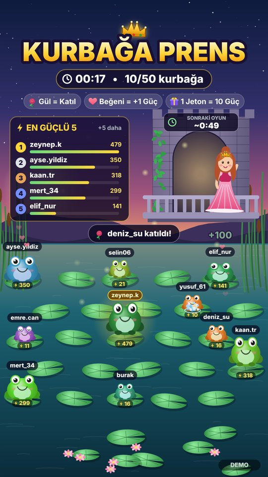
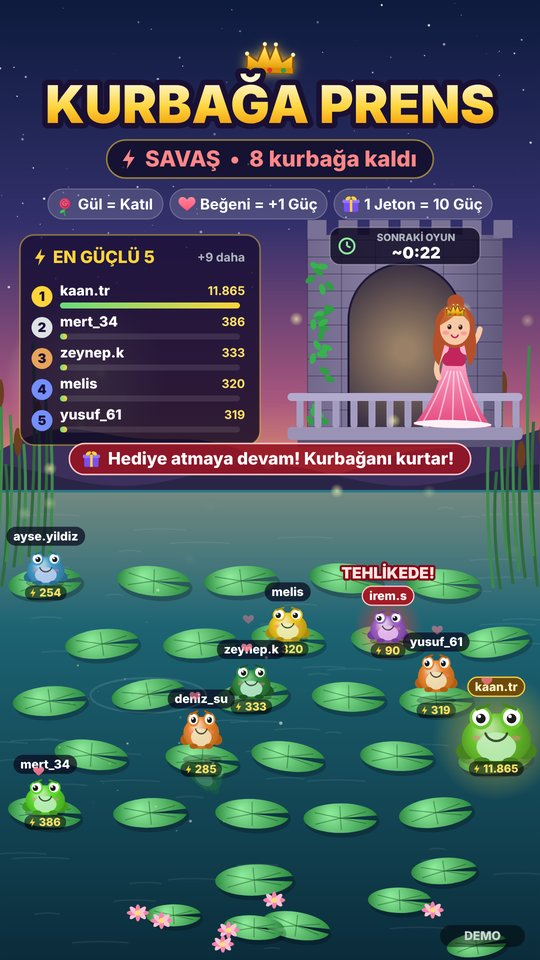
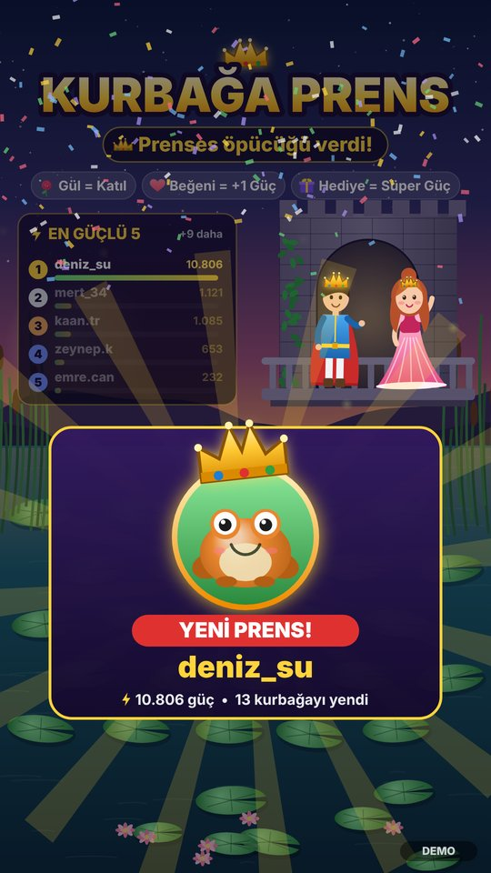
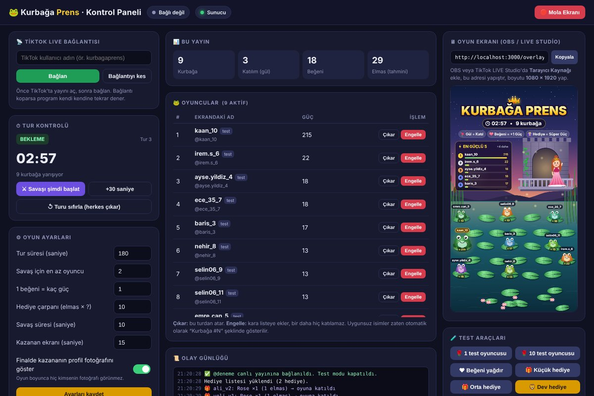

# 🐸👑 Kurbağa Prens — TikTok LIVE Oyunu

[](https://github.com/fatihergl/frog_prince_tiktok_game/actions/workflows/ci.yml)

İzleyiciler **gül** atarak kurbağa olur. **Beğeni** ve **hediyelerle** kurbağalarını güçlendirirler. Süre bitince kurbağalar savaşır, en güçlü kurbağa prensesi öper ve **prense dönüşür**. Kazananın adı ve profil fotoğrafı, üstünde bir **taçla** ekranda gösterilir.

<p align="center">
  
  
  
</p>

<p align="center"></p>

> **Gizlilik:** Oyun boyunca hiçbir oyuncunun profil fotoğrafı ekranda görünmez, sadece kullanıcı adları görünür. Fotoğraf yalnızca finalde kazananın kartında çıkar. Bunu da panelden tamamen kapatabilir ya da o an gizleyebilirsin.

---

## 1. Kurulum (bir kere yapılır)

1. **Node.js** kur: https://nodejs.org adresine git ve **LTS** sürümünü indirip kur.
2. Bu klasörü bilgisayarında bir yere çıkar (ör. `Belgeler/kurbaga-prens`).
3. Programı başlat:
   - **Windows:** `BASLAT-Windows.bat` dosyasına çift tıkla.
   - **Mac:** `BASLAT-Mac.command` dosyasına çift tıkla. İlk açılışta izin istenirse sağ tık → Aç.
   - **Elle başlatmak istersen:** Klasörde bir terminal aç ve sırayla `npm install` ve `npm start` yaz.

İlk açılışta gerekli paket otomatik olarak indirilir. Sonra tarayıcıda **kontrol paneli** açılır:
`http://localhost:3000/panel`

## 2. Oyun ekranını yayına eklemek

**TikTok LIVE Studio** veya **OBS** kullanabilirsin:

1. **Kaynak ekle → Tarayıcı (Browser)** seç.
2. Adres olarak `http://localhost:3000/overlay` gir.
3. Genişliği **1080**, yüksekliği **1920** yap.
4. OBS'de "Sesi OBS üzerinden kontrol et" seçeneğini işaretle. Oyunun sesleri (vırak, hediye, zafer müziği) böylece yayına gider.

Ses istemiyorsan adresin sonuna `?sound=0` ekle.

## 3. Yayın sırası

1. TikTok'ta canlı yayını **aç**.
2. Panelde kullanıcı adını yaz ve **Bağlan**'a bas. Başlıktaki ışık yeşil yanmalı.
3. Gerisi otomatik ilerler:
   - 🌹 **Gül** atan kişi kurbağa olarak oyuna girer. Bir turda **en fazla 50 kurbağa** olabilir. Tur doluyken gül atanlar otomatik olarak sonraki tura sıraya girer.
   - ❤️ Her **beğeni** = +1 güç (panelden değiştirilebilir).
   - 🎁 **Hediye:** **1 jeton = 10 güç**. Hediyenin jeton değeri × adet × 10. Örneğin 20 jetonluk Perfume +200 güç verir. Ekrandaki kural satırında ve her hediye bildiriminde bu hesap gösterilir ("Perfume = 20 jeton → +200 güç").
   - Kulenin üstündeki küçük **"Sonraki oyun"** sayacı yeni tura kalan süreyi gösterir. Bekleme ve savaş sırasında yaklaşık süreyi (~), kazanan ekranında ise kesin süreyi gösterir.
   - En az 2 oyuncu olunca süre başlar (varsayılan 3 dakika).
   - Süre bitince **savaş** başlar (varsayılan yaklaşık 20 saniye). Her adımda en zayıf kurbağa elenir.
   - Savaşta **hediye atmaya devam edilir**. Sıradaki elenecek kurbağa kırmızı **"TEHLİKEDE!"** yazısıyla işaretlenir, altındaki halka kalan süreyi gösterir. Sahibi ya da arkadaşları hediye atarsa kurbağa **"KURTULDU!"** efektiyle hayatta kalır.
   - Son kalan kurbağa prensesi öper, prense dönüşür ve taçlı kazanan kartı gösterilir.
   - Ardından yeni tur başlar. Yeni turda herkesin tekrar gül atması gerekir.

## 4. Kontrol paneli

| Bölüm | Ne işe yarar |
|---|---|
| **Tur kontrolü** | Savaşı hemen başlat, +30 saniye ekle, turu sıfırla |
| **Oyun ayarları** | Süreler, tur başına en fazla oyuncu (varsayılan 50), beğeni gücü, hediye çarpanı, kazanan fotoğrafı aç/kapat |
| **Oyuncular** | **Çıkar:** kişiyi bu turdan atar. **Engelle:** kara listeye ekler, bir daha hiç katılamaz |
| **Kazanan** | **Fotoğrafını gizle:** uygunsuz bir profil fotoğrafını anında kaldırır (kısayol: `H`) |
| **🛑 Mola Ekranı** | Ekranı anında "Kısa bir mola" perdesiyle kapatır (kısayol: `M`) |
| **Test araçları** | Sahte oyuncu ve hediye üretir. **Canlı yayına bağlıyken otomatik kilitlenir** ve test oyuncuları silinir |
| **Olay günlüğü** | Gelen her hediyeyi ve olayı gösterir |

## 5. Güvenlik önlemleri (hazır gelir)

- **İsim filtresi:** Küfürlü veya uygunsuz kullanıcı adları ekranda **"Kurbağa #N"** olarak görünür. Kendi kelimelerini `config.json` içindeki `extraBadWords` listesine ekleyebilirsin.
- **Kullanıcı adı gösterimi:** Varsayılan olarak TikTok kullanıcı adı (`@kullanici`) gösterilir, çünkü bu adlar sadece harf, rakam, `_` ve `.` içerebilir. Takma ad göstermek istersen `"nameSource": "nickname"` yap.
- **Fotoğraf:** Oyun sırasında hiç gösterilmez, sadece finalde kazanana gösterilir. İstersen tamamen kapatabilirsin.
- **Kara liste:** `data/blacklist.json` dosyasında tutulur ve program kapansa da silinmez.
- **Panel güvenliği:** Panel sadece senin bilgisayarından açılır (`127.0.0.1`). Ağdaki başkaları erişemez.

**Unutma:** Kazanana gerçek para veya ödül verme. Ödül sadece taç ve şöhret olsun. TikTok dışından (IBAN vb.) para isteme. Yayının başında ol, oyunu başıboş bırakma.

## 6. Ayarlar dosyası (`config.json`)

```json
{
  "port": 3000,
  "tiktokUsername": "kullanici_adin",
  "autoConnect": false,
  "signApiKey": "",
  "nameSource": "uniqueId",
  "extraBadWords": ["istemedigin_kelime"],
  "game": { "roundSeconds": 180, "minPlayers": 2, "maxPlayers": 50, "likePower": 1, "giftMultiplier": 10, "fightSeconds": 20, "winSeconds": 15, "showWinnerAvatar": true }
}
```

- `autoConnect: true` + `tiktokUsername` doluysa program açılır açılmaz yayına bağlanır.
- Panelden kaydettiğin ayarlar `data/settings.json` dosyasına yazılır ve `config.json`'daki oyun ayarlarının önüne geçer.
- **Günün prensleri** `data/hall-of-fame.json` dosyasında tutulur. Oyuncu yokken oyun ekranında gösterilir.

## 7. Sorun giderme

| Sorun | Çözüm |
|---|---|
| "Kullanıcı şu an canlı yayında değil" | Önce TikTok'ta yayını aç, sonra Bağlan'a bas |
| "kütüphane kurulu değil" | Klasörde `npm install` çalıştır |
| Bağlantı sık kopuyor / "sign" hatası | TikTok bağlantı imzası ücretsiz bir servis üzerinden alınıyor ve bu servisin sınırı var. https://www.eulerstream.com adresinden ücretsiz bir API anahtarı alıp `config.json` → `signApiKey` alanına yaz |
| "3000 portu kullanımda" | Program zaten açık olabilir. Değilse `config.json`'da `port` değerini değiştir (ör. 3001) |
| Oyun ekranında "Sunucu bağlantısı yok" | Siyah pencere (sunucu) kapanmış. Programı tekrar başlat |
| Hediyeler gelmiyor ama bağlı görünüyor | TikTok altyapısını değiştirmiş olabilir. Klasörde `npm update` çalıştır |

> **Not:** TikTok LIVE bağlantısı resmi olmayan, açık kaynaklı `tiktok-live-connector` kütüphanesiyle yapılıyor. Program yalnızca olayları **okur**; senin hesabına giriş yapmaz ve mesaj göndermez. TikTok bir değişiklik yaparsa bağlantı geçici olarak çalışmayabilir; genelde `npm update` ile düzelir. Yayında görünen her şeyden yayıncı sorumludur.

## 8. Dosya yapısı

```
kurbaga-prens/
├─ server.js              Sunucu: TikTok bağlantısı, panel komutları, kayıtlar
├─ config.json            Ayarlar
├─ public/
│  ├─ engine.js           Oyun kuralları (sunucu + demo ortak)
│  ├─ overlay.html        Oyun ekranı (1080×1920, OBS'ye bunu eklersin)
│  └─ panel.html          Kontrol paneli
├─ data/                  Kara liste, günün prensleri, kayıtlı ayarlar
├─ BASLAT-Windows.bat
└─ BASLAT-Mac.command
```

**Demo:** Sunucu olmadan oyunu görmek için `public/overlay.html` dosyasını doğrudan tarayıcıda aç. Sahte oyuncularla kendi kendine oynar.

## 9. Geliştirme

```bash
npm install      # bağımlılıklar
npm start        # sunucuyu başlat
npm test         # oyun motoru testleri (Node'un kendi test aracı)
npm run check    # sözdizimi kontrolü
```

GitHub'a her gönderimde testler **GitHub Actions** ile otomatik çalışır (`.github/workflows/ci.yml`).

Oyun kuralları `public/engine.js` dosyasında. Bu dosya hem sunucuda hem de tarayıcıdaki demo modunda aynen kullanılır. Kural değiştirdiğinde `test/engine.test.js` içine bir test eklemen önerilir.
